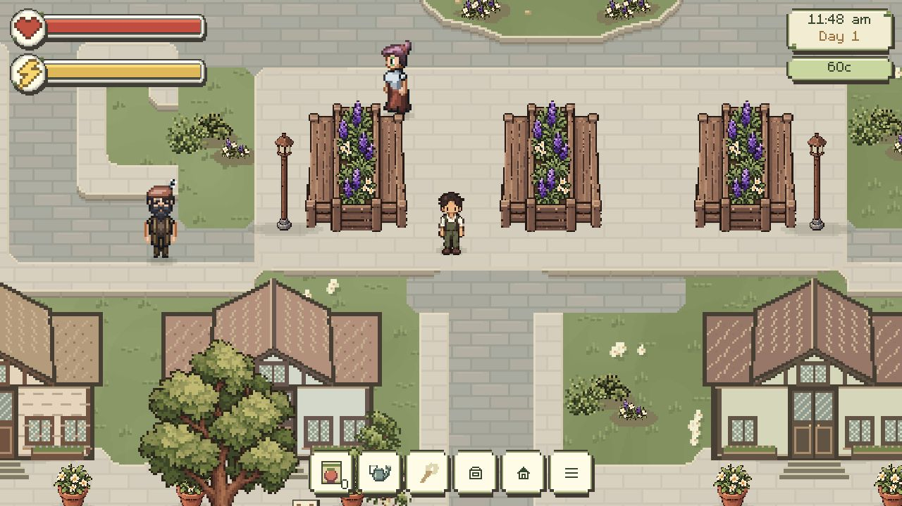
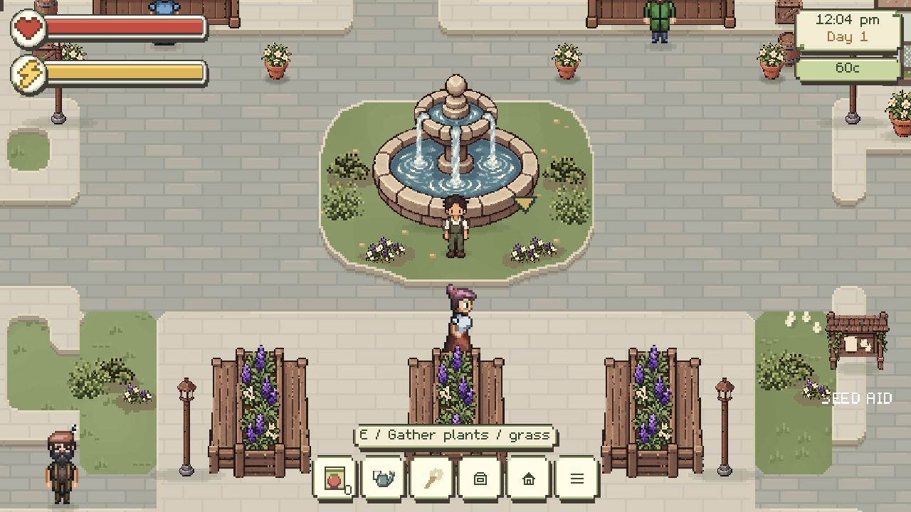
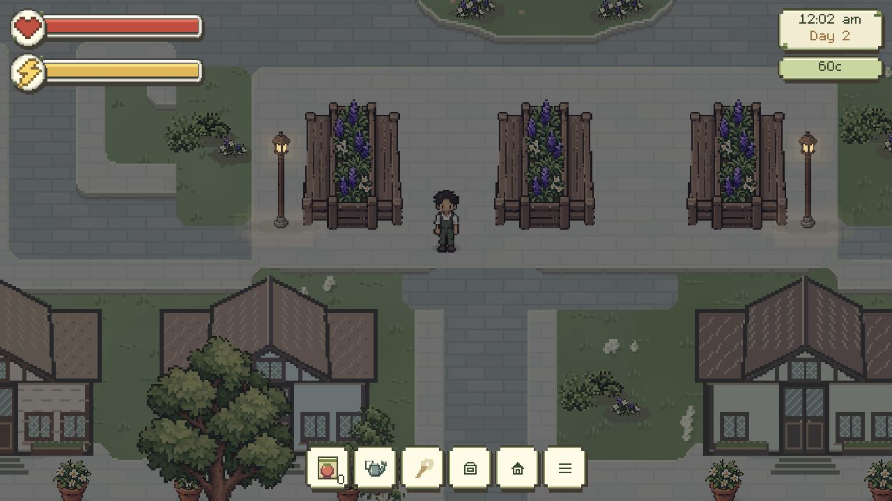
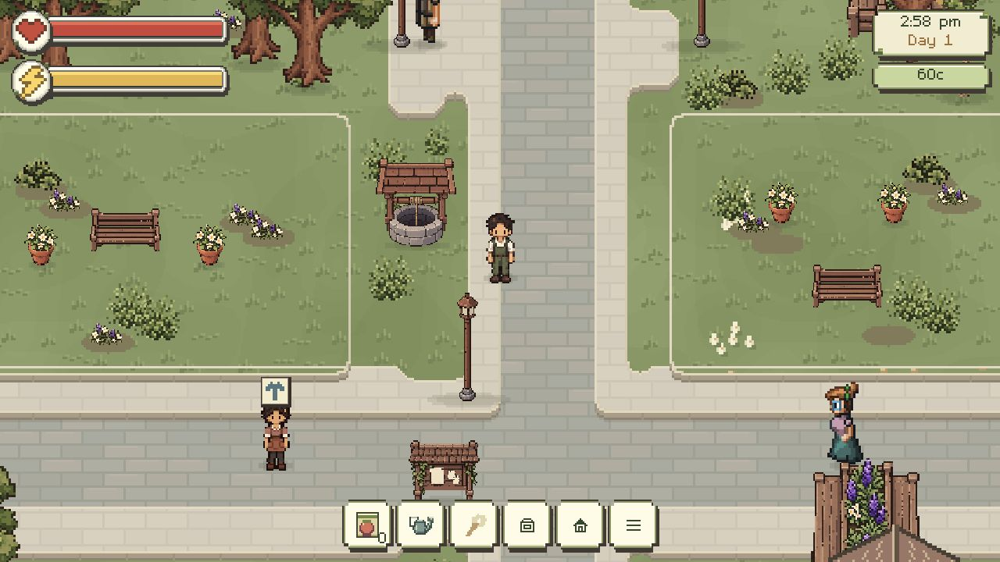
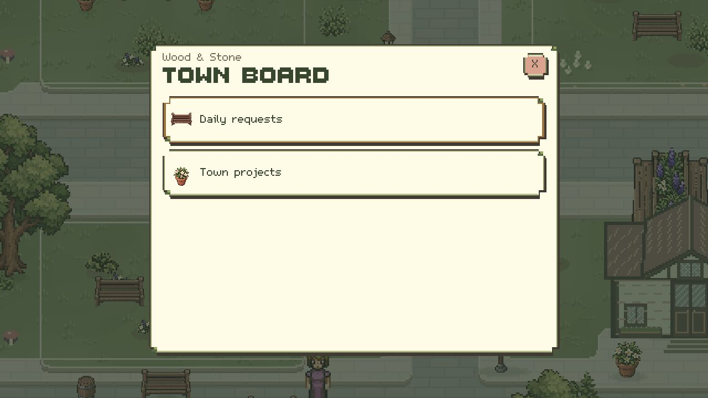

# v0.40.0 — approved City layout integration

User approved proposal03 for local integration, with the existing green land retained. No normal save was edited. Historical proposals01–03 remain separate and unchanged.

## Result

- Compact560×192cream terrace; existing planter benches at[469,580],[653,580],[837,580], scale1.5. Their visible clear gaps are88world units. All feet lie within the terrace; front/rear ground clearance is38/60world units.
- Warm-grey streets, small quiet cream pavers, continuous softened contour joins, shallow six-world-unit south-facing curb faces, pale top lips and narrow road contact shade. Lowered crossing masks preserve entrances. Curbs add no collisions.
- Approved fountain moves to[624,300] with its body/column/effect registration together; shaped low border, grouped approved foliage and modest clipped soil pockets. Existing green shader, palette, noise and grass flecks remain, replacing the preview's flat lawn bands.
- Clear cream cottage aprons keep existing house feet and flowerpots off the road. Two market lamps and two roots receive eight-unit acceptance adjustments for the visible curb face; their art stays unchanged.
- No new asset PNG. All public files and `groundSurface.js` hash-identical to the pre-integration baseline. Benches, houses, characters and other approved artwork/scales remain.

## Live browser evidence

Production build served on isolated local origin43865; fixture saves never use4215storage. Actual keyboard input and UI clicks through the Codex in-app browser; no injected player/state manipulation.

At1280×720, Continue loaded the actual game. Walking through the first/second bench gap reached[584,416]without jumping; June temporarily occupied the gap's centre and was passed within the same gap. Fountain navigation passed the existing market planter to reach[578,275], then the north loop[864,305], east side and south[704,543]. The board opened after walking from the gardens to[1691,1093]. Night fixture22:00showed glass emission and restrained pavement pools, while daytime stayed unlit. Completed project benches/pots remain visible. Money stayed60through non-transaction movement checks.

## Automated checks

`npm test`:375/375. `npm run build`:pass. Production remains48allowlisted files with no preview/source/vendor archives. `tests/city-layout.test.js` checks:

- all227City ground-plant and all tree identities retained, including every gathered node after validate/Continue; money/day retained;
- all public files and original grass shader exact;
- unchanged green pixels and correct six-unit curb/lowered crossing pixels;
- connected paved access using the actual24×12foot body, source house clearance and bridge rails, covering both bridges, two markets, aid/board, all10porches, fountain sides and both sides of all three terrace benches;
- instantiated NPC commutes and completed town-project approaches.

Existing tests still cover patrol samples, travel, day/night lamp logic, services, farming, Forest and saves. Earlier planter-placement assertions now follow the explicitly approved terrace positions, with physical access retained.

## Implementation and limits

Original data/code: `src/data/cityLayout.js`, `citySurfaceMasks.js`, `citySurfaceGeometry.js`, `applyCityLayout.js`, plus existing Terrain/City surface/vegetation/world-render hooks. Export with bundled Python/Pillow: `python scripts/export_city_layout.py` from the repository root. Historical proposal masks are retained inputs; no new foreign art or image generation. [Source record](../../assets/licenses/city-layout-v1/SOURCE_RECORD.md).

The actual current green material is preserved; existing gatherable cover beyond the90approved planting positions also remains on green ground, with stable identities. It is deliberately not deleted to imitate a90-sprite-only offline picture. Existing project cover suppression remains. No full user-save history, custom player-planted City grass under every newly paved edge, every NPC-hour combination, or mobile/touch device run was exhaustively simulated. Future building art must fit reserved parcels. Source runtime-only allowlisting remains unchanged. No deployment, publication, push or commit.
